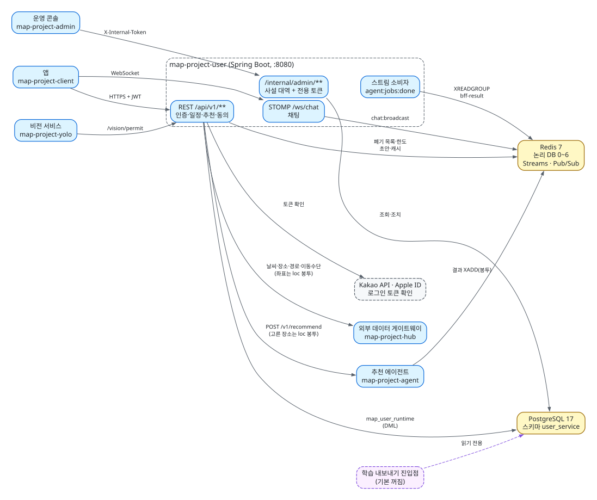

# map-project-user

앱이 부르는 유일한 백엔드(BFF). 인증·일정·채팅·동의를 맡고, 추천은 agent 에, 외부 데이터는 hub 에 중계한다. Spring Boot 3.5 · Java 17.

## 저장소 지도

MAP 는 일곱 저장소로 이루어져 있다. 전체 구조와 한 번에 실행하는 방법은 [map-project-infra](https://github.com/we-meet-trip/map-project-infra) 에서 시작한다.

| 저장소 | 역할 |
|---|---|
| [map-project-infra](https://github.com/we-meet-trip/map-project-infra) | 전체 안내, 로컬 실행 구성(Docker Compose), DB 초기화 |
| [map-project-client](https://github.com/we-meet-trip/map-project-client) | 모바일 앱(Flutter, iOS·Android) |
| **[map-project-user](https://github.com/we-meet-trip/map-project-user)** | **사용자 BFF(Spring Boot): 인증·일정·채팅·동의, 다른 서비스 중계** |
| [map-project-agent](https://github.com/we-meet-trip/map-project-agent) | 추천 에이전트(FastAPI·LangGraph): 장소·경로·일정 생성 |
| [map-project-hub](https://github.com/we-meet-trip/map-project-hub) | 외부 데이터 게이트웨이(FastAPI·PostGIS): 관광·날씨·장소·경로 |
| [map-project-yolo](https://github.com/we-meet-trip/map-project-yolo) | 비전 서비스(WebSocket, 객체 탐지 + LLM 식별) |
| [map-project-admin](https://github.com/we-meet-trip/map-project-admin) | 운영 콘솔(FastAPI·React) |

## 이름의 뜻

- `map-project` 는 MAP 프로젝트의 공개 저장소 묶음 이름이다. 일곱 저장소가 같은 접두를 쓴다.
- `user` 는 사용자 쪽 요청을 받는 서비스라는 뜻이다. 앱은 이 서비스 하나만 부르고, 계정·일정·대화처럼 사용자에게 딸린 데이터는 여기에만 있다.

## 개요

- 앱의 모든 요청이 이 서비스를 지난다. 다른 서비스(agent·hub)는 앱에 직접 열지 않는다.
- 사용자 데이터(계정·일정·추천 결과·채팅·동의)는 PostgreSQL 스키마 `user_service` 에만 쓴다.
- 서비스 사이로 나가는 좌표는 늘 봉투로 감싸고, 저장하는 본문은 따로 암호화한다.
- 서빙은 데이터베이스를 바꾸지 않는다. 마이그레이션과 빈 데이터베이스 준비는 같은 이미지의 다른 진입점이 한다.

## 구조

<picture>
  <source media="(prefers-color-scheme: dark)" srcset="docs/diagrams/bff-architecture-dark.svg">
  
</picture>

처리 순서·모듈·시간 제한은 [docs/architecture.md](docs/architecture.md), 로그인과 채팅 흐름 그림은 [docs/diagrams](docs/diagrams/) 에 있다.

## 기능

- **인증**: 이메일·비밀번호, 카카오(앱 SDK 가 받은 액세스 토큰 검증), Apple. RS256 JWT, refresh 는 세션 계열 단위로 회전하고 재사용되면 계열을 폐기한다. 인증 경로마다 요청 한도.
- **추천 중계**: 비동기 추천(`/api/v1/recommend`)과 결과까지 기다리는 동기 일정 생성(`/api/v1/trip/*`). 같은 조건 결과의 재사용과 동시 요청 공유, 계정당 하루 3회 재탐색.
- **일정**: 저장·시작·도착 기록, 저장 시점 예보를 기준선으로 두고 날씨가 바뀌면 알림, 한 번에 다시 짜기.
- **채팅**: 일정마다 대화방(STOMP), 초대 링크, 읽음·입력 중 표시, 신고·차단.
- **동의**: 서비스 약관·개인정보 처리방침·18세 이상, 외부 AI 사용 범위별 동의(`trip`·`vision`·`review_summary`).
- **중계**: 장소 검색·사진·리뷰 요약, 주변 장소, 대중교통·지하철, 공공자전거·공유 킥보드, 날씨(hub 경유).
- **운영 콘솔용 내부 API**: 회원·추천 작업 조회, DLQ 재처리, 신고 처리.

## 빠른 시작 (외부 키·비용 없이)

전체 서비스를 함께 띄우는 방법은 [map-project-infra](https://github.com/we-meet-trip/map-project-infra) 의 빠른 시작을 따른다. 그 순서가 이 서비스의 데이터베이스 준비(부트스트랩 → 마이그레이션)와 봉투 열쇠 생성까지 한다. 상태 확인: `http://127.0.0.1:8080/actuator/health`.

이 저장소만으로는 빌드와 테스트를 돌린다.

```sh
git clone https://github.com/we-meet-trip/map-project-user
cd map-project-user
docker compose up -d redis          # 테스트가 쓰는 Redis(로컬 6379)
./gradlew test                      # 외부 서비스·키 없이 도는 단위·통합 테스트(H2)
./gradlew bootJar trainingExportJar # build/libs/map-project-user-1.0.0.jar 등
```

- 6379 를 다른 프로세스가 쓰고 있으면 다른 포트로 띄우고 테스트에 알려 준다: `docker run --rm -d -p 6380:6379 redis:7-alpine` 뒤 `SPRING_DATA_REDIS_PORT=6380 ./gradlew test`.
- 이 저장소의 `docker-compose.yml` 은 로컬 개발용 PostgreSQL 17·Redis 만 띄운다. 빈 데이터베이스를 직접 세우려면 [docs/architecture.md](docs/architecture.md) 의 '데이터베이스 준비' 순서를 따른다.

## 설정

[.env.example](.env.example) 에 이 서비스가 읽는 환경변수가 빈 값으로 있다. 이 서비스만 읽는 값은 `USER_`, 다른 서비스와 같은 값을 함께 읽는 값은 `MAP_PROJECT_` 로 시작한다.

> **기본값은 로컬 실행용이다. 외부에 열기 전에 반드시 `USER_AUTH_ENFORCED=true` 로 켜고 JWT 키·내부 서비스 토큰·CORS 출처를 설정한다.** 자세한 표는 [SECURITY.md](SECURITY.md) 에 있다.

- 비우면 기동하지 않는 값: `MAP_PROJECT_LOCATION_WIRE_KEY`(좌표 봉투, hub·agent 와 같은 값), `USER_LOCATION_ENC_KEYS`·`USER_LOCATION_ENC_ACTIVE_KID`(저장 암호화).
- 비우면 꺼지는 기능: 카카오 로그인(`USER_KAKAO_APP_ID`), https 초대 링크(`USER_CHAT_INVITE_BASE_URL` — 비면 응답 `url` 이 null 이고 앱이 앱 전용 주소를 만든다), Apple 로그인(`USER_APPLE_ENABLED`).
- 기본 꺼짐: 학습 수집·내보내기, 리뷰 요약 선작성, 시험 계정 시더, 도보 연결선(미완성 실험 기능). 표는 [docs/architecture.md](docs/architecture.md) '기본 꺼짐 기능'.

## 데이터

이 저장소에는 외부 데이터셋이나 실제 사용자 데이터가 없다. 테스트는 합성 값만 쓴다. 이 서비스가 쌓는 데이터와 학습 수집 조건은 [docs/data.md](docs/data.md) 에 있다.

## API와 계약

경로·필드·오류 형식·한도·스트림·좌표 봉투 형식은 [docs/contracts.md](docs/contracts.md) 에 있다. 요약:

- 앱: `/api/v1/**`(REST, JWT), `/ws/chat`(STOMP). 오류는 `{timestamp, status, code, message}`.
- agent: `POST /v1/recommend` 로 접수, 결과는 Redis Streams `agent:jobs:done`(봉투)으로 받는다.
- hub: 날씨·장소·경로·이동수단, 좌표는 `loc` 봉투.
- 운영 콘솔: `/internal/admin/**`(사설 대역 + 전용 토큰).

## 폴더 구조

```
map-project-user/
├── src/main/java/map/project/user/   서빙 애플리케이션(UserApplication)
│   ├── domain/{auth,user}            로그인·JWT·회원
│   ├── recommend/ · trip/            추천 중계·동기 일정 생성
│   ├── schedule/ · weather/          일정·날씨 감시
│   ├── chat/ · moderation/           채팅·신고·차단
│   ├── policy/                       약관·AI 동의
│   ├── places/ nearby/ transit/ mobility/ vision/   hub 중계·비전 허가
│   ├── admin/                        운영 콘솔용 내부 API
│   └── global/                       보안·암호화·예외·요청 한도
├── src/main/java/map/{migration,bootstrap,database,export}/   서빙 밖 진입점
├── src/main/resources/
│   ├── application.yml               설정(환경변수 이름과 기본값)
│   └── db/migration/                 Flyway V001~
├── scripts/
│   ├── sql/                          빈 데이터베이스 준비 SQL(psql)
│   ├── verify-*.py                   부트 jar 기동 검사(CI)
│   ├── render_diagrams.sh · seq.py   그림 다시 그리기
├── docs/                             구조·계약·데이터·트러블슈팅·결정 기록·그림
├── Dockerfile · Dockerfile.training-export
└── docker-compose.yml                로컬 개발용 PostgreSQL·Redis
```

## 테스트

```sh
./gradlew test                                   # 전체(Redis 필요, 데이터베이스는 H2)
./gradlew test --tests '*ChatServiceTest'        # 일부만
python3 scripts/verify-user-migration-launch.py  # bootJar 뒤: 마이그레이션 진입점 검사(DB 연결 없음)
```

- CI(`.github/workflows/ci.yml`)는 전체 테스트, 부트 jar 검사 세 가지, 빈 PostgreSQL 17 에서 부트스트랩 순서 검증을 돈다.
- 테스트는 외부 서비스를 부르지 않는다(모의 서버·합성 열쇠).

## 트러블슈팅과 교훈

개발 중 실제로 겪은 문제 15건을 [docs/troubleshooting.md](docs/troubleshooting.md) 에 적었다. 예: 패턴 목적지로 남의 방 대화를 받던 구독 인가, 기록 실패를 삼키고 ack 해 사라지던 학습 신호, 앞단 프록시가 먼저 끊어 사유 없이 실패하던 일정 생성. 설계 결정은 [docs/decisions](docs/decisions/) 에 있다.

## 한계

- 운영 중인 서비스가 아니다. 공개본은 로컬·학습용으로 검증했다.
- 학습 수집·내보내기는 합성 데이터로만 시험했다.
- 도보 연결선은 미완성 실험 기능이다.
- 이전 판으로 V011·V015 를 적용한 데이터베이스는 체크섬을 한 번 맞춰야 한다([docs/architecture.md](docs/architecture.md)).
- V004 에는 쓰지 않는 초기 설계 테이블 7개가 남아 있다.

## 감사 표시

- 그림은 [Graphviz](https://graphviz.org/) 와 표준 라이브러리 스크립트로 그렸고, 글꼴은 [Pretendard](https://github.com/orioncactus/pretendard)(SIL Open Font License 1.1)를 쓴다. 글꼴 파일은 저장소에 넣지 않았다.
- 라이브러리: Spring Boot, Spring Security, Spring Data JPA·Redis, Flyway, jjwt, Lombok, H2(테스트) 등. 각 라이브러리는 자기 라이선스를 따른다.

## 고지

- 이 저장소는 교육·학습 목적으로 공개한 코드다. 운영 중인 서비스가 아니며 지원을 약속하지 않는다.
- 이 프로젝트는 코드가 연동하는 외부 서비스·데이터 제공자(한국관광공사, 기상청, 공공데이터포털, 국토교통부, 서울특별시, 한국환경공단, 카카오, 네이버, Google, Apple, LangChain, ODsay, OpenStreetMap, Ultralytics, Wikimedia 등)와 관련이 없으며, 그들로부터 승인이나 후원을 받지 않았다. 언급한 상표와 서비스 이름은 각 소유자에게 있다.
- 저장소에는 제3자 데이터·이미지·본문을 넣지 않는다. 예외로, 이용조건을 원문으로 확인한 공공·개방 자료만 출처와 이용조건을 밝혀 담는다(`docs/data.md`). 그 밖의 외부 데이터는 각 제공자의 약관에 따라 직접 받아야 한다.
- MIT 라이선스는 이 저장소의 코드에만 적용된다. 저장소에 담은 공공·개방 자료와 외부 데이터, 모델 가중치, 폰트, 라이브러리는 각자의 이용조건·라이선스를 따른다.

## 라이선스

코드는 [MIT 라이선스](LICENSE)를 따른다. Copyright (c) The MAP Contributors. 만든 사람들은 [AUTHORS.md](AUTHORS.md) 에 있다.
